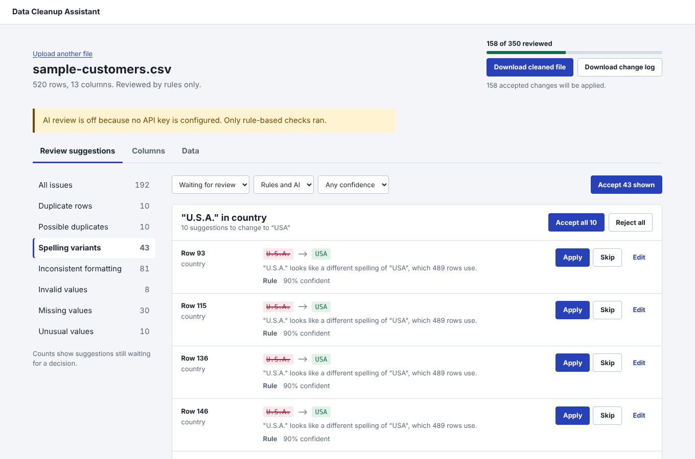

# Data Cleanup Assistant

Upload a CSV file and get a list of suggested fixes: duplicate rows, inconsistent spellings and formats, missing values, invalid entries and records that look wrong. You review each suggestion (or a whole group at once), then download the cleaned file together with a log of every change.

Nothing is changed automatically. The original upload is never modified, and the cleaned file is rebuilt from the original plus the suggestions you accepted.



## Quick start

### With Docker

```bash
cp .env.example .env          # optional: add ANTHROPIC_API_KEY to enable the AI checks
docker compose up --build
```

Open http://localhost:8080 and click **Try the sample file**.

### Without Docker

Requirements: Python 3.11+ and Node 20+.

```bash
make install

# in one terminal
export ANTHROPIC_API_KEY=sk-ant-...   # optional
make backend                          # API on http://localhost:8000, docs at /docs

# in another terminal
make frontend                         # UI on http://localhost:5173
```

Without an API key the app still works. It runs only the rule-based checks and says so in the UI.

## What it checks

| Problem | Example | How it is found |
|---|---|---|
| Exact duplicates | Same customer entered twice, once as `ANA RUIZ` and `01/05/2024` | Rows compared after normalizing case, spacing, dates, phones and numbers |
| Near duplicates | `Jonathan Smith` and `Jonathon Smith` with the same email | Fuzzy matching finds candidates, then the AI confirms or dismisses each pair |
| Spelling variants | `USA`, `usa`, `U.S.A.`, `United States` | Rules catch case, punctuation and typos; the AI catches synonyms |
| Mixed formats | `(415) 555-0100` next to `+14155550100`; `03/25/2024` next to `2024-03-25` | Per-column type detection, then conversion to one standard (E.164, ISO 8601) |
| Missing values | Empty cells, `N/A`, `null`, `-` | Placeholders are turned into real empty cells; empty cells are flagged |
| Invalid values | `ana@@mail.com`, `abc` in a price column | Type validation, with a repair proposed when one is obvious |
| Unusual values | A monthly spend of 3,100 when the rest are around 40 | Median/MAD outlier test, checked within groups (see below) |
| Suspicious records | A birth date after the signup date | The AI reviews a sample of rows, including the ones the rules flagged |

Each suggestion shows the current value, the proposed value, the reason, how confident the check is, and whether it came from a rule or the AI. You can apply it, skip it, or type a different value.

## How it works

```
upload ─► parse ─► profile columns ─► rule checks ─► AI checks ─► merge ─► review ─► export
           │            │                  │              │                    │
     encoding and   type of each      5 independent   3 bounded jobs,     accepted suggestions
     delimiter      column drives     detectors       each optional       replayed on the original
     detection      which checks run
```

The backend is a FastAPI application organized in layers:

```
backend/app/
  api/          HTTP routes and request/response schemas
  services.py   use cases: upload, analyze, review, export
  domain/       Suggestion, ColumnProfile and enums; no framework code
  pipeline/     ingest, profiling, the analyzer that runs everything, and apply/export
  detectors/    one module per kind of check, all with the same interface
  llm/          model provider interface, Anthropic adapter, response cache, prompts
  storage/      SQLite repository
```

The frontend is React with TypeScript, built with Vite. TanStack Query handles server state, including optimistic updates so accepting a group of 150 suggestions is instant.

## Design decisions

**Rules first, AI where it adds something.** Anything that can be computed exactly is computed in code: exact duplicates, date and phone formats, placeholders for missing values, statistical outliers. The model is used for the three things that need judgment or world knowledge: recognizing that `United States` and `USA` are the same, deciding whether two similar rows are really the same person, and spotting records that contradict themselves. This keeps the cost low, makes most of the system testable without a model, and means that a model mistake cannot affect the deterministic checks.

**The model never sees the whole file.** Each AI job gets only what it needs: the distinct values of one column, the two rows of a candidate pair, or a sample of at most 60 rows. This keeps prompts small regardless of file size and limits how much data leaves the server. The limits are configurable.

**Model output is validated against the input.** Responses are requested as structured output (a forced tool call with a JSON schema) and parsed with Pydantic. Any answer that refers to a value, pair, row or column that was not in the request is discarded. The system prompt tells the model that cell contents are untrusted data, which matters because a CSV can contain text written to manipulate it.

**The AI is optional and can fail safely.** Each AI job runs separately. If the API key is missing, a request times out, or the response is malformed, that job is skipped, the UI shows a warning, and the rule-based results are still returned.

**Suggestions are patches, not edits.** The uploaded file is stored as-is and never rewritten. A suggestion is a small record (`row 12, column phone, from X to Y, because Z`). Export replays the accepted ones on the original. This gives undo for free, makes the result reproducible, and produces the change log as a by-product.

**One change per cell.** Several checks can want to change the same cell (trimming spaces and fixing a spelling variant, for example). Detectors run in a fixed order and the later, more specific one wins, so the reviewer never sees two competing proposals for one cell. Flags, which do not change data, are always kept.

**Outliers are judged within their group.** In the sample data an Enterprise plan costs about eight times a Basic plan. A plain outlier test flagged every Enterprise customer (25 false positives). The detector now reports a value only if it is also extreme within each small category it belongs to, which removed all of them without losing a real outlier.

**Bulk actions skip flags.** "Accept all" applies to value changes and row removals. Flagged items such as outliers have no automatic fix, so they always need a person to look at them.

**Why these tools.** Python because the core of the problem is data processing, and pandas, rapidfuzz, phonenumbers and dateutil have no equal in the JS ecosystem. FastAPI for typed request validation and generated API docs. SQLite because a single-user tool should not need a database server; all SQL is in one module, so moving to Postgres would change one file. Background analysis uses FastAPI's background tasks with polling instead of a job queue like Celery, because one process is enough here and a queue would add infrastructure without a benefit.

## Evaluation

`scripts/generate_dataset.py` builds a 500-customer file, injects 327 known problems of 15 kinds and saves the ground truth. `scripts/evaluate.py` runs the analysis and compares the suggestions to that ground truth.

```bash
make sample      # regenerate sample_data/ (fixed seed, so the numbers below are reproducible)
make evaluate
```

Results with the rule-based checks only:

| | |
|---|---|
| Recall (injected problems found) | 94.2% |
| Precision (suggestions that point at a real problem) | 100% |
| Proposed fixes that restore the original value | 268 of 268 |

The problems the rules miss are the ones they are not designed to catch: country synonyms (`United States`, `US`) and birth dates that fall after the signup date. Those are the cases the AI checks are for. Set `ANTHROPIC_API_KEY` and run `make evaluate` again to measure them.

## Tests and quality checks

```bash
make test    # 57 backend tests + frontend type check and build
make lint    # ruff, ruff format, mypy --strict, eslint
```

The tests cover parsing edge cases (encodings, delimiters, duplicate headers), type inference, every detector, the analyzer with a fake model (including invalid and failing responses), patch application and the HTTP API end to end. CI runs the same checks on every push.

## API

Interactive docs are at http://localhost:8000/docs when the backend is running.

| Method | Path | Purpose |
|---|---|---|
| `POST` | `/api/datasets` | Upload a file; analysis starts in the background |
| `GET` | `/api/datasets/{id}` | Status, progress, column profile, warnings |
| `GET` | `/api/datasets/{id}/rows` | Paged original rows |
| `GET` | `/api/datasets/{id}/suggestions` | All suggestions |
| `PATCH` | `/api/datasets/{id}/suggestions/{sid}` | Accept or reject one, optionally with your own value |
| `POST` | `/api/datasets/{id}/suggestions/bulk` | Accept or reject many |
| `GET` | `/api/datasets/{id}/export` | Cleaned CSV |
| `GET` | `/api/datasets/{id}/audit` | Change log as CSV |

## Configuration

Environment variables (or a `.env` file in `backend/`):

| Variable | Default | |
|---|---|---|
| `ANTHROPIC_API_KEY` | none | Enables the AI checks |
| `LLM_MODEL` | `claude-sonnet-5-5` | Model used for the AI checks |
| `DATA_DIR` | `./data` | Uploaded files and the SQLite database |
| `MAX_UPLOAD_MB` | `20` | |
| `MAX_ROWS` | `100000` | |
| `DEFAULT_PHONE_REGION` | `US` | Region used to read phone numbers without a country code |
| `LLM_MAX_REVIEW_ROWS` | `60` | Rows sent for the record review |
| `LLM_MAX_DUPLICATE_PAIRS` | `60` | Candidate pairs sent for confirmation |

## Limitations and next steps

- Single user, no authentication. Adding accounts would mean scoping datasets by owner in the repository and the API.
- Files are processed in memory, which is fine up to the 100,000-row limit. Larger files would need chunked processing, and the duplicate search would need blocking keys instead of the similarity matrix.
- The record review looks at a sample, not every row. Running it over the whole file in batches is a matter of cost, not code.
- Cross-column rules (end date after start date, city matching state) are left to the AI. If a team knows its own rules, letting it declare them would be more reliable than inferring them.
- The cleaned file is exported as comma-separated UTF-8 regardless of the input format.
